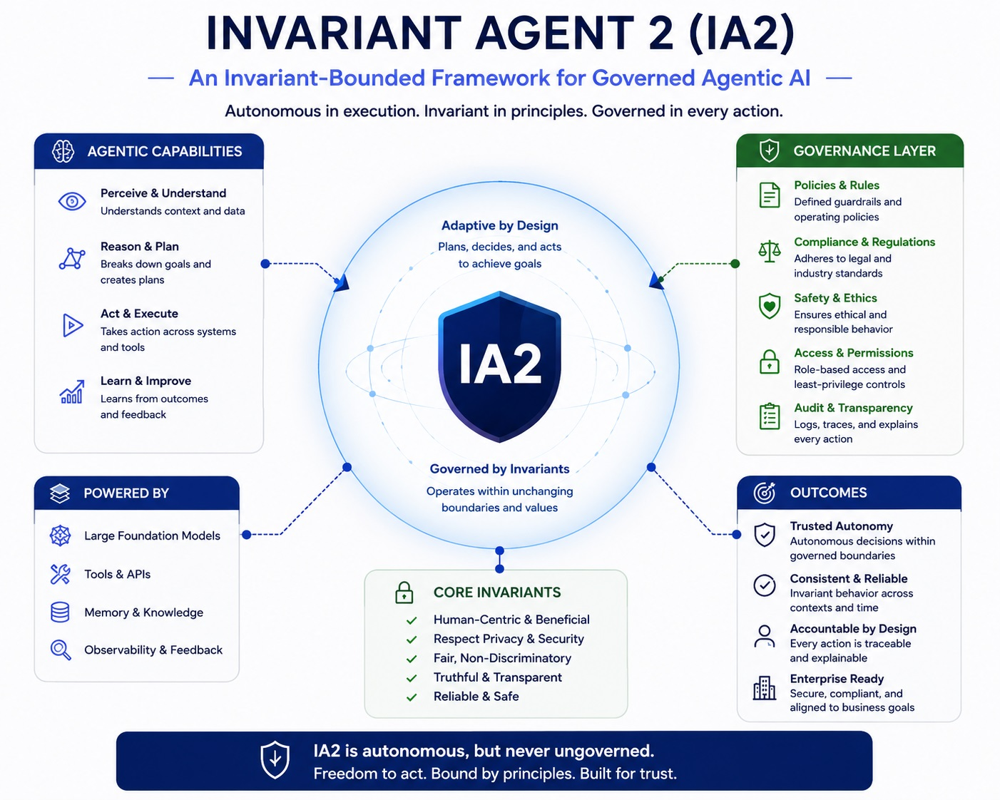

# InvariantAgent2 (IA2)



A reference implementation of the **Invariant-Bounded Agent Alignment Model (IBAAM)**.

InvariantAgent2 explores governed agent runtimes where behavioural constraints remain external to adaptive cognition. Rather than allowing an LLM to directly govern system behaviour, all actions, state transitions, and self-modifications are evaluated under invariant-based runtime control.

## Why InvariantAgent2?

Most agent frameworks place the LLM at the centre of decision making.

InvariantAgent2 takes a different approach.

The planner (LLM or otherwise) is treated as an untrusted cognitive component that proposes actions. Runtime governance, invariant enforcement, and state transition control remain external to the planner.

This enables adaptive agents to evolve while maintaining:

- explicit behavioural constraints
- replayable execution
- auditable decision making
- governed self-modification
- bounded behavioural evolution

InvariantAgent2 serves as a reference implementation of the **Invariant-Bounded Agent Alignment Model (IBAAM)**.

## Quick Start

```bash
dotnet run --project src/InvariantAgent.ConsoleApp
```

Example:

```text
agent> calc 10+20
[Lifecycle] Phase: InputReceived
[Input] calc 10+20
[Lifecycle] Phase: Planning
[Planning] Capability=calc
[Lifecycle] Phase: PlanValidation
[Invariant] NoDeleteInvariant: Passed
[Invariant] AllowedCapabilityInvariant: Passed
[Control] Plan invariants passed
[Lifecycle] Phase: Execution
[Execution] 30
[Lifecycle] Phase: ExecutionValidation
[Invariant] SuccessOutcomeInvariant: Passed
[Invariant] NonEmptyOutcomeInvariant: Passed
[Control] Execution invariants passed
[Lifecycle] Phase: SelfModificationValidation
[Invariant] AllowedMemoryKeyInvariant: Passed
[Control] SelfModification invariants passed
[Lifecycle] Phase: Reduction
[Reduction] ProposedVersion=1
[Invariant] BehaviouralDriftBoundInvariant: Passed
[Invariant] RejectedTransitionCannotCommitInvariant: Passed
[Control] Reduction invariants passed
[Lifecycle] CommittedVersion=1
[Lifecycle] Phase: Completed
Transition Id: 5594c376-2201-4616-b35f-dd126458bf57
Status: Completed
```

## Core Idea

LLMs are treated as **cognitive generators**, not governing authorities.

Every proposed action passes through invariant-bounded runtime control before execution or state mutation occurs.

The runtime governs:

- planning
- execution
- state evolution
- self-modification
- transition persistence
- behavioural auditing

## Runtime Hierarchy

```text
invariants
    >
runtime governance
    >
planner
    >
capabilities
```

Invariants define admissible behavioural boundaries.

The runtime governs transitions.

Planners propose actions.

Capabilities perform execution.

Reducers assimilate approved state evolution.

## Hierarchical Invariant Governance

Invariants can be assigned a governance layer:

```text
Fundamental > Mission > Behavioural > AdaptiveHeuristic
```

Context-aware hierarchical governance (HIG-C) extends same-layer conflict handling with invariant criticality and the current operational context. Priority is still evaluated first; criticality and context help distinguish equal-priority soft conflicts.

Fundamental invariants are non-negotiable by default. Lower-layer `Info` and `Warning` violations may be overridden only when all applicable higher-priority invariants are preserved. `Error` and `Critical` violations remain blocking unless a future domain-specific policy explicitly authorises otherwise.

Override decisions are recorded as control events with:

- the overridden invariant and layer
- HIG-C criticality, context, and conflict outcome when applicable
- the preserved higher-priority invariants
- a generated justification
- audit metadata for governance review

Meta-invariants are first-class governance components:

- `PriorityMetaInvariant` validates hierarchy precedence.
- `OverrideSeverityMetaInvariant` keeps `Error` and `Critical` violations blocking by default.
- `JustificationMetaInvariant` requires an inspectable override rationale.
- `AuditMetaInvariant` marks override decisions for governance review.
- `ReviewMetaInvariant` flags ambiguous or noisy override situations, such as same-layer conflicts or multiple simultaneous violations.

This keeps priority, justification, auditability, and review signals explicit without weakening existing hard safety constraints.

## Architecture

```text
Core
  Contracts, models, transitions, projections

Runtime
  Governed transition lifecycle orchestration

Control
  Pre/post invariant enforcement

Execution
  Capability execution and mediation

Adaptive
  Planners, memory, self-modification proposals

Observability
  Replay, drift analysis, stability evaluation, transition tracing

Conscience
  Functional conscience (IBAAM 6): history-calibrated appraisal inside the invariants

Storage
  Transition, baseline and commitment persistence
```

## IBAAM Mapping

| InvariantAgent2 Component | IBAAM Layer |
|--------------------------|-------------|
| Planner | Adaptive Layer |
| Runtime | Execution Layer |
| Invariants | Control Layer (Agent Behavioural Controls) |
| Conscience | Functional conscience, contained by the Control Layer (IBAAM 6) |
| Replay & Drift Analysis | Observability Layer |
| Reducers | State Assimilation |
| Transition Store | Persistence |

## Governed Transition Lifecycle

Every interaction executes through a governed transition pipeline:

```text
Input
 -> Planning
 -> Pre-Control
 -> Conscience: plan appraisal (Proceed | Revise -> re-plan -> Pre-Control again | Escalate | Veto)
 -> Capability Execution
 -> Post-Control
 -> State Assimilation
 -> Conscience: answer appraisal (Proceed | caveat | Escalate | Veto)
 -> Transition Persistence
```

Every transition records:

- prior state
- proposed action
- execution outcome
- invariant decisions
- adaptive modifications
- resulting state

Rejected transitions are also persisted and remain available for:

- replay
- auditing
- drift analysis
- governance inspection

## Example Governed Transition

The following session demonstrates:

- planning
- invariant evaluation
- capability execution
- state evolution
- rejected actions
- replay and auditing
- governed self-modification
- drift analysis

All state changes occur only after invariant approval.

### Quick Example

```text
agent> calc 10+20
[Lifecycle] Phase: InputReceived
[Input] calc 10+20
[Lifecycle] Phase: Planning
[Planning] Capability=calc
[Lifecycle] Phase: PlanValidation
[Invariant] NoDeleteInvariant: Passed
[Invariant] AllowedCapabilityInvariant: Passed
[Control] Plan invariants passed
[Lifecycle] Phase: Execution
[Execution] 30
[Lifecycle] Phase: ExecutionValidation
[Invariant] SuccessOutcomeInvariant: Passed
[Invariant] NonEmptyOutcomeInvariant: Passed
[Control] Execution invariants passed
[Lifecycle] Phase: SelfModificationValidation
[Invariant] AllowedMemoryKeyInvariant: Passed
[Control] SelfModification invariants passed
[Lifecycle] Phase: Reduction
[Reduction] ProposedVersion=1
[Invariant] BehaviouralDriftBoundInvariant: Passed
[Invariant] RejectedTransitionCannotCommitInvariant: Passed
[Control] Reduction invariants passed
[Lifecycle] CommittedVersion=1
[Lifecycle] Phase: Completed
Transition Id: 5594c376-2201-4616-b35f-dd126458bf57
Status: Completed

agent> memory-set goal=learn IBAAM
[Lifecycle] Phase: InputReceived
[Input] memory-set goal=learn IBAAM
[Lifecycle] Phase: Planning
[Planning] Capability=memory-set
[Lifecycle] Phase: PlanValidation
[Invariant] NoDeleteInvariant: Passed
[Invariant] AllowedCapabilityInvariant: Passed
[Control] Plan invariants passed
[Lifecycle] Phase: Execution
[SelfModification] memory.set goal
[Execution] Proposed memory update: goal
[Lifecycle] Phase: ExecutionValidation
[Invariant] SuccessOutcomeInvariant: Passed
[Invariant] NonEmptyOutcomeInvariant: Passed
[Control] Execution invariants passed
[Lifecycle] Phase: SelfModificationValidation
[Invariant] AllowedMemoryKeyInvariant: Passed
[Control] SelfModification invariants passed
[Lifecycle] Phase: Reduction
[SelfModification] Set goal
[Reduction] ProposedVersion=2
[Invariant] BehaviouralDriftBoundInvariant: Passed
[Invariant] RejectedTransitionCannotCommitInvariant: Passed
[Control] Reduction invariants passed
[Lifecycle] CommittedVersion=2
[Lifecycle] Phase: Completed
Transition Id: 90a02255-8610-4b90-99fe-380151a9e5cd
Status: Completed

agent> boo
[Lifecycle] Phase: InputReceived
[Input] boo
[Lifecycle] Phase: Planning
[Planning] Capability=boo
[Lifecycle] Phase: PlanValidation
[Invariant] NoDeleteInvariant: Passed
[Invariant] AllowedCapabilityInvariant: Failed Capability 'boo' is not allowed or unknown.
[Control] Plan invariants failed: AllowedCapabilityInvariant: Capability 'boo' is not allowed or unknown.
[Lifecycle] Phase: Rejected
Transition Id: ced39314-d599-4813-9f9b-b0d8cadf82d4
Status: Rejected
```

## State Projection

Planners do not receive unrestricted access to runtime state.

Instead they operate on a bounded projection:

```text
π(Sₜ)
```

containing:

- goals
- memory summaries
- prior outcomes
- active policies
- runtime versioning

This creates a controlled cognitive interface between adaptive reasoning and governed execution.

## Self-Modification Governance

InvariantAgent2 supports governed adaptive evolution.

Capabilities may propose:

- memory updates
- goal changes
- policy evolution
- future adaptive modifications

Capabilities cannot directly modify runtime state.

Instead:

1. A modification is proposed.
2. Invariants evaluate admissibility.
3. Approved changes are assimilated by reducers.

Example:

```text
memory-set goal=plan a healthy weekly routine
```

The modification becomes part of runtime state only after successful governance evaluation.

## Behavioural Stability Evaluation

InvariantAgent2 includes a behavioural stability evaluation layer that measures how agent behaviour changes over time without replacing invariant-based governance.

The stability evaluator consumes transition history, capability usage, state changes, outcomes, and invariant failures to produce:

- stability vectors
- drift magnitude
- stability regions
- governance recommendations

These measurements indicate behavioural change. Invariants remain responsible for determining whether change is acceptable.

## Functional Conscience (IBAAM 6)

IBAAM 6 (*Conscience Within Controls*) adds a functional conscience that weighs what the agent **should** do inside the
boundary the invariants set on what it **may** do. It has its own contract (`IConscience`), separate from
`IInvariant`, so it cannot be registered as an invariant, and it is only consulted after the relevant invariants
pass. No stance can authorise anything an invariant blocks.

The default implementation, `HistoryCalibratedConscience`, is deterministic: the same plan and the same history give
the same appraisal, while a different history can give a different one. Each appraisal is graded and decomposed:

| Component | What it estimates | Source |
|-----------|-------------------|--------|
| Violation risk | Probability that similar plans were blocked by the controls (the only calibrated probability) | Precedent transitions, pulled towards the deployment base rate |
| Forecast drift | Drift the plan's resulting state would produce, as (score / bound)² | Precedents at the plan point; a dry run of the commit at the answer point |
| Trend pressure | Remaining tolerance given recent behaviour | Current stability region |
| Commitment conflict | Inconsistency with the agent's own commitments and reviewer decisions | Commitment store |

Plan-specific tension (`p = 1 - Π(1 - vᵢ)^wᵢ` over violation risk, forecast drift and commitment conflict) is
amplified by trend pressure (`tension = 1 - (1 - p)^(1 + w·trend)`), so unstable history makes real concerns weigh more
but never stops a plan on its own. Commitment conflict uses closeness rescaled from the match threshold, so only plans
close to the declined conduct weigh heavily. Tension selects a stance: **Proceed**, **Revise** (the appraisal is returned to the
planner for up to two re-plans; every revised plan passes the plan invariants again and is re-appraised; at the limit,
or when the planner cannot produce a different plan, it becomes Escalate), **Escalate** (held for human review) or
**Veto**. The justification is generated from the components, citing precedent transitions
("resembles #8f273d76, blocked by AllowedMemoryKeyInvariant [memory-integrity]").

Revise, Escalate and Veto create **commitments** (conversation-scoped for Revise, user-scoped for Escalate and Veto).
A reviewer resolves an escalation with `conscience-review <id> uphold|overturn [note]`, which records a reviewer
commitment that takes precedence over the agent's own. Appraisals are recorded on the transition, so
`replay validate` reproduces conscience decisions without re-running the conscience.

Mitigations for the feedback loop in IBAAM 6, Section 9: transitions the conscience stopped are not used as boundary
labels or as instability in trend pressure, and `conscience calibration` reports the Brier score of violation risk
against realised control outcomes, including how many appraised plans have no realised outcome.

Example (literal command planner, so Revise cannot re-plan and escalates):

```text
agent> memory-set password=hunter2
[Conscience] Plan appraisal: Proceed (tension 0.20) -> Proceeded
[Control] SelfModification invariants failed: AllowedMemoryKeyInvariant: Memory key 'password' is not allowed.
agent> memory-set password=letmein
[Conscience] Plan appraisal: Revise (tension 0.62) -> Escalated [planner 'command' could not produce a different plan]
Reason: Conscience escalated for human review (conscience-review 67e722e2 uphold|overturn): Revise (tension 0.62):
violation risk 0.58 - 1 of 1 similar plans were blocked by the controls (#8f273d76 blocked by
AllowedMemoryKeyInvariant [memory-integrity], sim 0.60); base rate 0.33; ...
```

The second write never executes: the conscience anticipated the control outcome. With an LLM planner the appraisal is
added to the prompt and the model re-plans.

Configure with `AddInvariantAgent(dataDirectory, conscience => { ... })` (`ConscienceOptions`: thresholds, weights,
revision limit, commitment scopes and lifetime, exempt capabilities). Disable it with
`conscience => conscience.Enabled = false`, or `--InvariantAgent:Conscience:Enabled=false` in the console app.
Thresholds are conservative placeholders; tuning them against a human-labelled set is the next empirical step.

## Features

- Governed transition runtime
- Invariant-bounded execution
- Replayable transition history
- Drift and behavioural stability analysis
- Adaptive memory
- Governed self-modification
- Capability mediation
- Pre/post execution control
- Replaceable planners
- Deterministic execution paths
- Event-oriented state evolution
- Runtime observability
- Behavioural stability evaluation
- Functional conscience within the controls (IBAAM 6)

## Planner Support

- OpenAI planners
- Google Gemini planners
- Deterministic command planners
- Extensible planner abstraction

## Current Capabilities

- `echo`
- `search`
- `calc`
- `explain`
- `replay`
- `replay verbose`
- `replay validate` (re-evaluates history against the current invariants; report-only)
- `drift`
- `memory-set`
- `memory-show`
- `baseline-show`
- `baseline-approve`
- `conscience [commitments | pending | calibration | last | <id>]`
- `conscience-review <id> uphold|overturn [note]`

Additional capabilities can be added through the capability registry.

## Running

```bash
dotnet run --project InvariantAgent.ConsoleApp
```

Entry point:

```text
InvariantAgent.ConsoleApp/Program.cs
```

### Persistence

The console app persists to a data directory (default: `data/` next to the executable):

- `transitions.jsonl` - every transition, completed or rejected, one JSON object per line
- `baselines.jsonl` - every approved drift baseline; the last one is current
- `commitments.jsonl` - every conscience commitment (agent and reviewer), append-only

On restart the runtime resumes from the last committed state. Choose another location with
`--InvariantAgent:DataDirectory=<path>` or the `InvariantAgent__DataDirectory` environment variable.
`AddInvariantAgent()` with no data directory keeps everything in memory (used by the tests).

### Deterministic replay

Each transition records the drift baseline in force when its reduction invariants ran
(`Transition.DriftBaseline`). `replay validate` scores behavioural drift against that recorded baseline, so its
result depends only on the recorded history and the current rules, not on baselines approved later. Replay does
not write to the drift tracker. History recorded before this field existed falls back to the current baseline and
is flagged in verbose output.

## Research

InvariantAgent2 serves as the reference implementation of the:

### Invariant-Bounded Agent Alignment Model (IBAAM)

## Research Directions

Current areas of investigation include:

- governed adaptive evolution
- bounded self-modification
- runtime-enforced alignment
- transition-governed cognition
- behavioural drift measurement
- replayable agent execution
- invariant-based behavioural stability assessment
- functional conscience contained by deterministic controls

The project remains intentionally experimental and architecture-focused.

## Citing InvariantAgent2

If you use Invariant Agent 2 in your research, please cite it:

```bibtex
@software{invariantagent2026,
  author  = {Long, Brad},
  title   = {Invariant Agent 2 (IA2)},
  year    = {2026},
  url     = {https://github.com/xagyg/InvariantAgent2}
}
```

## Appendix

### Example Drift Report
Larger or repeated memory changes increase measured behavioural drift, which can move the stability assessment from normal monitoring toward watch or intervention recommendations.

```text
agent> drift
[Lifecycle] Phase: InputReceived
[Input] drift
[Lifecycle] Phase: Planning
[Planning] Capability=drift
[Lifecycle] Phase: PlanValidation
[Invariant] NoDeleteInvariant: Passed
[Invariant] AllowedCapabilityInvariant: Passed
[Control] Plan invariants passed
[Lifecycle] Phase: Execution
[Execution]
==== DRIFT REPORT ====
Transitions: 1
Rejected: 0
Total drift score: 40
Highest drift severity: Warning
Stability region: Stable
Stability confidence: Low
Stability drift magnitude: 0

Stability vector:
  Identifiability: 100
  Continuity: 60
  Consistency: 100
  Persistence: 70
  Recovery: 100
  Average: 86.0

Governance recommendations:
  Continue normal monitoring.

Capability usage:
  memory-set: 1

Invariant failures:
  none

Invariant failures by category:
  none

Drift events:
  BehaviouralDrift: 1

Recent drift:
  [Warning] BehaviouralDrift Score=40 Phase=Completed Transition=08df9a82-79fc-467d-acba-3984d1dfd6ac
    goal changed from '<empty>' to 'learn IBAAM'; adaptive memory changed (+1/-0/~0)
==== END DRIFT REPORT ====
[Lifecycle] Phase: ExecutionValidation
[Invariant] SuccessOutcomeInvariant: Passed
[Invariant] NonEmptyOutcomeInvariant: Passed
[Control] Execution invariants passed
[Lifecycle] Phase: SelfModificationValidation
[Invariant] AllowedMemoryKeyInvariant: Passed
[Control] SelfModification invariants passed
[Lifecycle] Phase: Reduction
[Reduction] ProposedVersion=2
[Invariant] BehaviouralDriftBoundInvariant: Passed
[Invariant] RejectedTransitionCannotCommitInvariant: Passed
[Control] Reduction invariants passed
[Lifecycle] CommittedVersion=2
[Lifecycle] Phase: Completed
Transition Id: 98571e6c-248d-4f7e-a1f1-743754824b5b
Status: Completed
```
